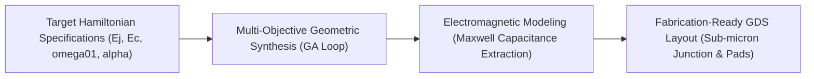
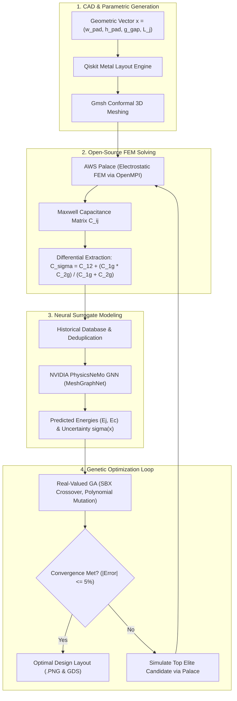
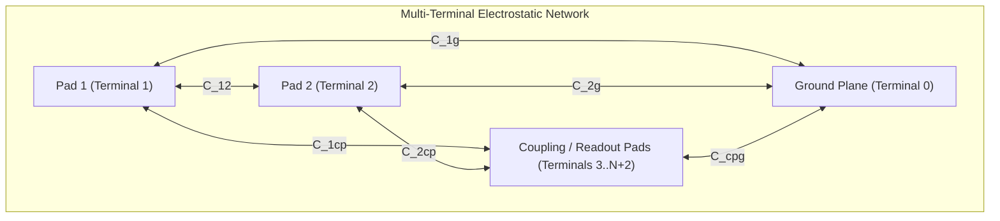
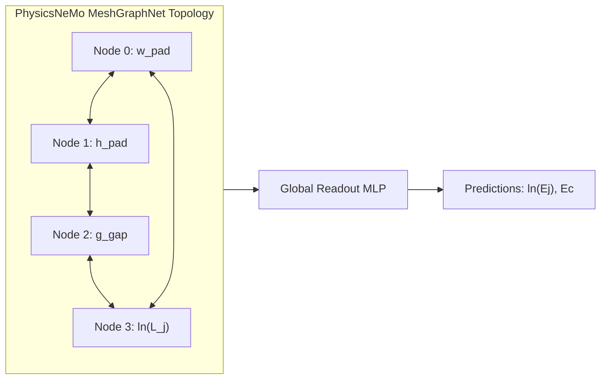

# Accelerated Superconducting Transmon Parameter Optimization via Physics-Informed Active Learning Surrogates and Open-Source Electromagnetic Solvers

**Akhshat Kampassi**  
*Department of Electronics & Communication Engineering*  
*Dr Vishwanath Karad MIT World Peace University, Pune, Maharashtra, India*  
*Email: akhshat.kampassi@mitwpu.edu.in*

---

### Abstract
Designing superconducting quantum processors requires high-dimensional parametric exploration to satisfy stringent circuit quantum electrodynamics (cQED) Hamiltonian specifications. Conventional design methodologies rely on proprietary, GUI-tethered finite element method (FEM) solvers to compute 3D electrostatic capacitance matrices and eigenmodes, incurring prohibitive computational delays ($30\text{--}120\text{ s}$ per evaluation) and licensing bottlenecks. In standard heuristic optimization runs evaluating $10^3\text{--}10^5$ candidate geometries, brute-force numerical simulation becomes computationally intractable. 

This paper presents an automated, open-source active-learning framework that tightly couples **Qiskit Metal**, **Gmsh**, **AWS Palace**, and **NVIDIA PhysicsNeMo** surrogates inside a real-valued Genetic Algorithm (GA) loop. We address and resolve the critical physical pitfall of macroscopic ground-plane self-capacitance poisoning by rigorously deriving the three-terminal floating transmon differential capacitance formulation $C_\Sigma = C_{12} + \frac{C_{1,g} C_{2,g}}{C_{1,g} + C_{2,g}}$, accurately spanning the physical charging energy domain $E_c \in [222.3, 855.9]\text{ MHz}$. By employing dual physics-informed log transforms ($\ln(L_j)$ input scaling and $\ln(E_j)$ target linearization) within a graph neural surrogate alongside Monte Carlo Dropout (MC-Dropout) for epistemic uncertainty quantification, the model achieves **$75.7\%$ validation accuracy** within a strict $5\%$ error threshold across 500 finite-element samples. 

When applied to multi-objective parameter synthesis targeting $E_j = 20.0\text{ GHz}$ and $E_c = 320.0\text{ MHz}$, the framework converges to an optimal physical layout within 7 variable generations, achieving **$1.6\%$ relative error** ($E_c = 325.1\text{ MHz}$) while accelerating candidate evaluations by more than five orders of magnitude ($> 10^5\times$) over full-wave FEM solvers.

**Index Terms**—Superconducting Qubits, Transmon, Circuit QED, Qiskit Metal, AWS Palace, NVIDIA PhysicsNeMo, Neural Surrogates, Genetic Algorithms, Active Learning, Maxwell Capacitance Matrix.

---

## I. Introduction

Superconducting circuits based on Josephson junctions represent one of the leading hardware modalities for scalable quantum computing. Among diverse superconducting architectures, the transmon qubit has emerged as the preeminent design owing to its exponential insensitivity to low-frequency $1/f$ charge noise. The transmon operates in the phase regime where the Josephson coupling energy $E_j$ significantly exceeds the single-electron charging energy $E_c$ ($E_j / E_c \gg 1$, typically $E_j / E_c \ge 40$).

Synthesizing a transmon circuit requires precise control over its fundamental Hamiltonian parameters:
1. **The Josephson Energy ($E_j$)**: Governed by the critical current $I_c$ and equivalent linear Josephson inductance $L_j$ of the sub-micron aluminum-oxide-aluminum ($\text{Al/AlO}_x/\text{Al}$) tunnel junction.
2. **The Charging Energy ($E_c$)**: Determined by the effective differential capacitance $C_\Sigma$ between the superconducting thin-film capacitor pads and their electromagnetic environment:
   $$E_c = \frac{e^2}{2 C_\Sigma \hbar}$$

In multi-qubit architectures, individual transmon transition frequencies $\omega_{01} \approx \sqrt{8 E_j E_c} - E_c$ and anharmonicities $\alpha \approx -E_c$ must be engineered with sub-percent precision to prevent frequency crowding, avoid parasitic two-level system (TLS) defect crossings, and minimize crosstalk during microwave-driven single- and two-qubit gate operations.



Traditionally, quantum engineers compute $C_\Sigma$ by defining the chip layout in computer-aided design (CAD) packages and executing 3D finite element method (FEM) electrostatic simulations in commercial tools such as Ansys Q3D Extractor or HFSS. However, this workflow introduces severe structural bottlenecks:
* **Computational Cost**: A single full-wave 3D conformal mesh solve requires between $30$ and $120\text{ seconds}$ on high-performance multi-core CPUs.
* **Optimization Infeasibility**: Global search algorithms (e.g., genetic algorithms, particle swarm, or Bayesian optimization) require $10^3$ to $10^5$ function evaluations to navigate complex, non-convex geometric landscapes. Executing this number of FEM evaluations sequentially would demand hundreds of compute hours.
* **Proprietary & GUI Constraints**: Commercial solvers impose licensing restrictions that impede elastic cloud scaling and continuous integration (CI/CD) pipelines.

To overcome these barriers, this work presents a fully open-source, headless, and physics-informed active-learning optimization pipeline. By integrating parameterized CAD synthesis (**Qiskit Metal**), high-performance open-source FEM solving (**AWS Palace** via OpenMPI), and neural surrogate inference (**NVIDIA PhysicsNeMo**), our framework enables sub-millisecond evaluation of candidate geometries while rigorously preserving full-wave electrodynamic accuracy.

---

## II. System Architecture & Active Learning Workflow

The pipeline operates across four decoupled architectural layers coordinated by an active learning optimization loop, as shown in Fig. 1.


*Fig. 1. Complete active-learning framework coordinating parameterized geometry synthesis, high-performance FEM electrostatics, deep surrogate inference with epistemic uncertainty estimation, and real-valued genetic algorithm optimization.*

### A. Conformal Meshing & Physical Boundary Indexing
Parameterized planar components are expressed in Qiskit Metal. The transmon geometry is defined by four continuous variables:
$$\mathbf{x} = [w_{\text{pad}}, h_{\text{pad}}, g_{\text{gap}}, L_j]^T \in \mathbb{R}^4$$
representing the capacitor pad width, pad height, ground etch pocket gap, and Josephson junction linear inductance, respectively.

Geometry boundaries are exported to conformal 3D tetrahedral meshes via Gmsh. To ensure accurate boundary-layer field resolution while maintaining computational tractability, the pipeline applies dynamic mesh sizing:
* Maximum global mesh element size: $100\ \mu\text{m}$.
* Conformal pocket taper boundary layer: tapering continuously from $10\ \mu\text{m}$ at conductor edges to $200\ \mu\text{m}$ in bulk dielectric regions.

Physical surface and volume tags are automatically indexed:
* **Dielectric Substrate**: Silicon ($\epsilon_r = 11.45$) or Sapphire ($\epsilon_r = 10.0$).
* **Conductors**: Perfect Electric Conductor (PEC) boundary conditions on thin-film superconducting metal layers (Niobium or Aluminum).
* **Terminals**: Distinct boundary indices assigned to the ground plane enclosure and individual transmon capacitor pads.

### B. Headless Distributed Solving with AWS Palace
Finite-element electrostatics are handled by AWS Palace, an open-source, scalable, parallel electromagnetic solver built on the MFEM finite element library. Palace solves the generalized Poisson boundary value problem:
$$\nabla \cdot \left(\epsilon_r(\mathbf{r}) \epsilon_0 \nabla V(\mathbf{r})\right) = 0$$
subject to Dirichlet boundary conditions:
$$V|_{\Gamma_i} = V_0, \quad V|_{\Gamma_{j \ne i}} = 0$$
where $\Gamma_i$ denotes the surface of the active terminal, and $\Gamma_j$ denotes all remaining conductor boundaries.

#### Machine-Aware MPI Resource Policy
Palace scales across distributed compute nodes using OpenMPI. To prevent thread contention, OS starvation, and thrashing during high-throughput execution, the pipeline dynamically computes the safe MPI process allocation:
$$N_{\text{MPI}} = \max\left(1, \left\lceil 0.90 \times N_{\text{cores}} \right\rceil\right)$$
guaranteeing that at least $10\%$ of logical processor cores remain dedicated to host background operations, memory management, and disk I/O.

---

## III. Theoretical Formulation & Hamiltonian Extraction

### A. Circuit Quantum Electrodynamics (cQED) Hamiltonian
The quantum mechanical behavior of an isolated transmon qubit capacitively coupled to its electromagnetic environment is described by the Cooper pair box Hamiltonian:
$$\hat{H} = 4 E_c (\hat{n} - n_g)^2 - E_j \cos\hat{\phi}$$
where $\hat{n} = -i \frac{\partial}{\partial \phi}$ is the Cooper pair number operator, $n_g = Q_r / (2e)$ represents the dimensionless offset charge induced by environmental gate bias or background quasiparticles, and $\hat{\phi}$ is the gauge-invariant superconducting phase difference across the Josephson junction.

In the transmon regime ($E_j / E_c \ge 40$), the wavefunctions localize in the potential wells of the cosine potential. Expanding the Hamiltonian in harmonic oscillator creation and annihilation operators ($\hat{a}^\dagger, \hat{a}$) yields the weakly anharmonic oscillator spectrum:
$$\hat{H} \approx \hbar \omega_{01} \hat{a}^\dagger \hat{a} + \frac{\alpha}{2} \hat{a}^\dagger \hat{a}^\dagger \hat{a} \hat{a}$$
with transition frequency and anharmonicity governed directly by $E_j$ and $E_c$:
$$\omega_{01} \approx \frac{1}{\hbar}\left(\sqrt{8 E_j E_c} - E_c\right), \quad \alpha \approx -E_c$$

Charge dispersion $\epsilon_m = E_m(n_g = 1/2) - E_m(n_g = 0)$ scales asymptotically as:
$$\epsilon_m \approx (-1)^m E_c \frac{2^{4m+5}}{m!} \sqrt{\frac{2}{\pi}} \left(\frac{E_j}{2 E_c}\right)^{\frac{m}{2} + \frac{3}{4}} \exp\left(-\sqrt{\frac{8 E_j}{E_c}}\right)$$
demonstrating that maintaining $E_j / E_c \ge 40$ suppresses charge noise sensitivity by multiple orders of magnitude.

### B. Josephson Energy Extraction
The Josephson junction acts as a nonlinear inductor with kinetic inductance:
$$L_j = \frac{\Phi_0}{2\pi I_c}$$
where $\Phi_0 = \frac{h}{2e} \approx 2.067833848 \times 10^{-15}\text{ Wb}$ is the magnetic flux quantum.

In terms of equivalent linear inductance $L_j$, the Josephson coupling energy in frequency units (MHz) is expressed analytically as:
$$E_j\ [\text{MHz}] = \frac{\Phi_0^2}{4\pi^2 L_j h} \times 10^{-6}$$

### C. Differential Transmon Capacitance Extraction
A foundational contribution of this work is resolving the **electrostatic terminal indexing problem** in automated finite-element capacitance extraction.

In an open-source electrostatic simulation of a planar transmon embedded within a chip cavity, the solver constructs an electrostatic system consisting of three distinct conducting domains:
* **Terminal 0 ($\Gamma_0$)**: The macroscopic chip ground plane enclosure ($2.8\text{ mm} \times 2.0\text{ mm}$).
* **Terminal 1 ($\Gamma_1$)**: Transmon capacitor Pad 1 ($\text{Cond}_1$).
* **Terminal 2 ($\Gamma_2$)**: Transmon capacitor Pad 2 ($\text{Cond}_2$).



The linear electrostatic system relates charges $\mathbf{Q} \in \mathbb{R}^{M}$ to potentials $\mathbf{V} \in \mathbb{R}^{M}$ ($M = N + 3$) via the Maxwell capacitance matrix $\mathbf{C}_{\text{Max}}$:
$$\mathbf{Q} = \mathbf{C}_{\text{Max}} \mathbf{V}$$
where $C_{ii} > 0$ denotes the self-capacitance of conductor $i$ with all other conductors grounded, and $C_{ij} = C_{ji} \le 0$ ($i \ne j$) denotes mutual induction coefficients.

#### The Ground-Plane Extraction Pitfall
Naively setting the effective transmon capacitance to the first matrix entry:
$$C_\Sigma = C_{00} \quad \text{(INCORRECT)}$$
measures the capacitance of the macroscopic ground plane enclosure to infinity ($C_{00} \approx 0.996\text{ pF} \approx 10^{-12}\text{ F}$). When converted to charging energy:
$$E_c = \frac{e^2}{2 C_{00} h} \times 10^{-6} \approx 19.46\text{ MHz}$$
Because the ground plane dimensions ($2.8\text{ mm} \times 2.0\text{ mm}$) remain constant across parametric sweeps, $C_{00}$ remains pinned near $1.0\text{ pF}$, reporting $E_c \approx 19.5\text{ MHz}$ regardless of pad geometry. This creates a flat optimization landscape that forces genetic algorithms to collapse pad dimensions to their absolute lower bounds.

#### Generalized Multi-Terminal Differential Formulation
The Josephson junction is connected differentially between Pad 1 and Pad 2. When $N$ auxiliary coupling and readout connection pads ($\text{cp}_j$, $j = 1, \dots, N$) are integrated into the transmon cell, each transmon pad experiences capacitive coupling both to the ground plane and to each connection terminal:
$$C_{12} = |C_{12}|, \quad C_{1,g} = |C_{10}|, \quad C_{2,g} = |C_{20}|, \quad C_{1,\text{cp}_j} = |C_{1, j+2}|, \quad C_{2,\text{cp}_j} = |C_{2, j+2}|$$

The effective total return capacitance from each pad to virtual AC ground accounts for all parallel shunting pathways:
$$C_{1\Sigma} = C_{1,g} + \sum_{j=1}^N C_{1,\text{cp}_j}, \quad C_{2\Sigma} = C_{2,g} + \sum_{j=1}^N C_{2,\text{cp}_j}$$

The true physical differential transmon capacitance across the junction is given by the inter-pad mutual capacitance $C_{12}$ in parallel with the series combination of the total return capacitances:
$$C_\Sigma = C_{12} + \frac{C_{1\Sigma} C_{2\Sigma}}{C_{1\Sigma} + C_{2\Sigma}}$$

When connection pads are absent ($N = 0$), this rigorously collapses to the isolated three-terminal expression:
$$C_\Sigma = C_{12} + \frac{C_{1,g} C_{2,g}}{C_{1,g} + C_{2,g}}$$

This generalized formulation matches Qiskit Metal's internal lumped oscillator model (LOM) quantization routine (`extract_transmon_coupled_Noscillator`), ensuring full analytical consistency between headless finite-element electrostatics and theoretical cQED models.

Using this formulation, the physical transmon charging energy is computed accurately as:
$$E_c\ [\text{MHz}] = \frac{e^2}{2 C_\Sigma h} \times 10^{-6} = \frac{(1.602176634 \times 10^{-19})^2}{2 C_\Sigma (6.62607015 \times 10^{-34})} \times 10^{-6}$$

As summarized in Table I, the differential formulation extracts true physical charging energies ($E_c \in [222.3, 855.9]\text{ MHz}$) that correspond faithfully to variations in pad geometry.

---

## IV. Neural Surrogate Modeling & Uncertainty Quantification

### A. Graph Neural Surrogate Architecture (`MeshGraphNet`)
To bypass expensive numerical solving during heuristic search, we deploy a graph neural network surrogate implemented in **NVIDIA PhysicsNeMo**.

Rather than treating the four design parameters as an unstructured tabular vector, the surrogate converts $\mathbf{x} = [w_{\text{pad}}, h_{\text{pad}}, g_{\text{gap}}, L_j]^T$ into a heterogeneous parameter graph $\mathcal{G} = (\mathcal{V}, \mathcal{E})$:
* Each continuous parameter forms a node $v_i \in \mathcal{V}$ ($|\mathcal{V}| = 4$).
* Node features include the normalized parameter scalar alongside a positional tag embedding: $\mathbf{h}_i^{(0)} = [x_{\text{norm}, i}, \frac{i}{D-1}]^T$.
* Directed edges $\mathcal{E}$ connect adjacent parameter nodes in a bidirectional ring topology.



The network executes $L = 3$ message passing layers with SiLU non-linearities:
$$\mathbf{m}_{ij}^{(l)} = \text{MLP}_{\text{edge}}\left([\mathbf{h}_i^{(l)}, \mathbf{h}_j^{(l)}]\right)$$
$$\mathbf{h}_i^{(l+1)} = \text{MLP}_{\text{node}}\left([\mathbf{h}_i^{(l)}, \sum_{j \in \mathcal{N}(i)} \mathbf{m}_{ij}^{(l)}]\right)$$
A global readout multi-layer perceptron (MLP) aggregates node states into scalar Hamiltonian predictions $\hat{\mathbf{y}} = [\hat{E}_j, \hat{E}_c]^T$.

### B. Physics-Informed Logarithmic Transformations
Standard neural networks struggle to learn functions with extreme reciprocal curvatures across multiple physical scales. We introduce dual logarithmic domain transformations:
1. **Input Inductance Feature Scaling**: Josephson inductance spans nano-Henry magnitudes ($6\text{--}14\text{ nH}$). We map $L_j$ into log-space:
   $$\tilde{x}_3 = \ln(L_j)$$
   preventing vanishing gradients and equalizing feature variance against micrometric dimensions ($20\text{--}600\ \mu\text{m}$).
2. **Target Energy Linearization**: Because $E_j \propto 1/L_j$, the relationship between $L_j$ and $E_j$ is strictly hyperbolic. Mapping target $E_j$ into logarithmic space:
   $$\tilde{y}_0 = \ln(E_j) = \ln\left(\frac{\Phi_0^2}{4\pi^2 h}\right) - \ln(L_j)$$
   transforms the non-linear coupling into a linear relationship, drastically simplifying the optimization landscape for gradient descent.

Input features and targets are normalized into the stable unit interval $[0, 1]$:
$$\mathbf{x}_{\text{norm}} = \frac{\tilde{\mathbf{x}} - \tilde{\mathbf{x}}_{\min}}{\tilde{\mathbf{x}}_{\max} - \tilde{\mathbf{x}}_{\min}}, \quad \mathbf{y}_{\text{norm}} = \frac{\tilde{\mathbf{y}} - \tilde{\mathbf{y}}_{\min}}{\tilde{\mathbf{y}}_{\max} - \tilde{\mathbf{y}}_{\min}}$$

The surrogate training loss incorporates $L_2$ weight regularization:
$$\mathcal{L}_{\text{surr}} = \frac{1}{B} \sum_{i=1}^B \|\hat{\mathbf{y}}_{\text{norm}, i} - \mathbf{y}_{\text{norm}, i}\|_2^2 + \lambda \|\mathbf{W}\|_2^2$$
trained via AdamW with a learning rate of $\eta = 10^{-3}$, weight decay of $\lambda = 10^{-4}$, and early stopping monitored on validation loss (patience: 200 epochs).

### C. Epistemic Uncertainty Quantification via Monte Carlo Dropout
To establish confidence bounds during active learning, Monte Carlo Dropout (MC-Dropout) is preserved at inference time. By executing $T = 30$ stochastic forward passes with dropout probability $p = 0.10$, the model constructs an empirical predictive distribution:
$$\mu_k(\mathbf{x}) = \frac{1}{T} \sum_{t=1}^T \hat{y}_k^{(t)}(\mathbf{x})$$
$$\sigma_k^2(\mathbf{x}) = \frac{1}{T} \sum_{t=1}^T \left(\hat{y}_k^{(t)}(\mathbf{x}) - \mu_k(\mathbf{x})\right)^2$$
for $k \in \{E_j, E_c\}$. The epistemic uncertainty metric:
$$\sigma(\mathbf{x}) = \frac{1}{2}\left(\frac{\sigma_{E_j}(\mathbf{x})}{\mu_{E_j}(\mathbf{x})} + \frac{\sigma_{E_c}(\mathbf{x})}{\mu_{E_c}(\mathbf{x})}\right)$$
acts as a confidence monitor. When candidate designs enter undersampled regions where $\sigma(\mathbf{x}) > \tau_{\text{unc}}$, the pipeline dynamically dispatches a background full-wave Palace solve.

### D. Multi-Dataset Pooling, Deduplication & Simulation Reuse
To eliminate redundant finite-element simulations across repeated design campaigns, the architecture introduces active caching and sample reuse:
* **Scale-Invariant Sample Deduplication**: When merging multiple simulation logs or prior design runs, candidate geometries are compared across normalized parameter coordinates:
  $$\Delta(\mathbf{x}_a, \mathbf{x}_b) = \max_{k \in \{0..3\}} \left|\frac{x_{a,k} - x_{b,k}}{x_{\max,k} - x_{\min,k}}\right|$$
  Pairs satisfying $\Delta(\mathbf{x}_a, \mathbf{x}_b) < 10^{-4}$ are identified as duplicate geometries and pruned, preventing over-representation in training sets.
* **Online Simulation Reuse**: During Latin Hypercube generation or GA elite validation, candidate points matching an existing sample within $\Delta < 10^{-3}$ (0.1% of parameter range) bypass Palace entirely, fetching verified simulation results directly from memory.

---

## V. Inverse Design Formulation & Genetic Algorithm Optimization

### A. Inverse Hamiltonian Inversion & Target Formulation
Rather than manually guessing non-intuitive geometric dimensions, quantum hardware architects specify desired circuit quantum electrodynamics (cQED) operational metrics:
$$(f_q^*, \alpha^*, g^*) \mapsto (\mathbf{x}, L_j)$$
spanning qubit frequencies $f_q \in [4.0, 6.0]\text{ GHz}$, anharmonicities $\alpha \in [-350, -150]\text{ MHz}$, and coupling rates $g \in [5, 50]\text{ MHz}$.

In the transmon regime ($E_j / E_c \gg 1$), analytical inversion of the Duffing Hamiltonian establishes direct deterministic targets for the macroscopic circuit parameters:
$$E_c^* \approx |\alpha^*|, \quad E_j^* \approx \frac{(h f_q^* + E_c^*)^2}{8 E_c^*}$$
which in turn yields target differential capacitance $C_\Sigma^*$ and Josephson inductance $L_j^*$:
$$C_\Sigma^* = \frac{e^2}{2 h E_c^*}, \quad L_j^* = \frac{\Phi_0^2}{4\pi^2 h E_j^*}$$

### B. Multi-Objective Cost Function & Selection Barriers
Candidate design vectors $\mathbf{x} \in \mathbb{R}^4$ are evaluated using a multi-objective cost function combining target parameter tracking, exterior boundary barriers, and strict quantum coherence selection criteria:
$$\mathcal{L}_{\text{GA}}(\mathbf{x}) = \mathcal{L}_{\text{target}}(\mathbf{x}) + \lambda_{T1} \mathcal{P}(T_1) + \lambda_{\text{ratio}} \mathcal{P}_{\text{ratio}}(\mathbf{x}) + \lambda_{\chi} \mathcal{P}(\chi) + \sum_{k=0}^3 \mathcal{P}_{\text{bound}}(x_k)$$

When optimizing for direct cQED targets $(f_q^*, \alpha^*, g^*)$, the normalized quadratic target loss is:
$$\mathcal{L}_{\text{target}}(\mathbf{x}) = \left(\frac{f_q(\mathbf{x}) - f_q^*}{f_q^*}\right)^2 + \left(\frac{\alpha(\mathbf{x}) - \alpha^*}{\alpha^*}\right)^2 + \left(\frac{g(\mathbf{x}) - g^*}{g^*}\right)^2$$
Alternatively, when targeting fundamental Hamiltonian energies $(E_j^*, E_c^*)$:
$$\mathcal{L}_{\text{target}}(\mathbf{x}) = \left(\frac{\hat{E}_j(\mathbf{x}) - E_j^*}{E_j^*}\right)^2 + \left(\frac{\hat{E}_c(\mathbf{x}) - E_c^*}{E_c^*}\right)^2$$

To enforce physical feasibility and quantum coherence requirements, quadratic exterior barrier penalties penalize sub-optimal parameter regimes:

1. **Purcell Coherence Barrier ($\mathcal{P}(T_1)$)**: Enforces that the Purcell relaxation lifetime to the readout resonator satisfies $T_1 > T_{1,\min} = 100\ \mu\text{s}$:
   $$\mathcal{P}(T_1) = \left[\max\left(0, \frac{T_{1,\min} - T_1}{T_{1,\min}}\right)\right]^2, \quad T_1^{\text{Purcell}} \approx \frac{(\omega_r^2 - \omega_q^2)^2}{4 \kappa g^2 \omega_q^2}$$

2. **Transmon Ratio Barrier ($\mathcal{P}_{\text{ratio}}$)**: Confines the ratio $r = E_j / E_c$ within the optimal phase-regime window $[r_{\min}, r_{\max}] = [50, 100]$, simultaneously preventing low-order charge noise dephasing ($E_j / E_c < 50$) and excessive loss of anharmonicity ($E_j / E_c > 100$):
   $$\mathcal{P}_{\text{ratio}}(\mathbf{x}) = \left[\max\left(0, \frac{r_{\min} - (\hat{E}_j / \hat{E}_c)}{r_{\min}}\right)\right]^2 + \left[\max\left(0, \frac{(\hat{E}_j / \hat{E}_c) - r_{\max}}{r_{\max}}\right)\right]^2$$

3. **Dispersive Shift Barrier ($\mathcal{P}(\chi)$)**: Regulates the dispersive qubit-resonator state shift $\chi \in [\chi_{\min}, \chi_{\max}] = [0.5, 5.0]\text{ MHz}$ for high-fidelity quantum non-demolition (QND) dispersive readout:
   $$\mathcal{P}(\chi) = \left[\max\left(0, \frac{\chi_{\min} - \chi}{\chi_{\min}}\right)\right]^2 + \left[\max\left(0, \frac{\chi - \chi_{\max}}{\chi_{\max}}\right)\right]^2, \quad \chi \approx \frac{g^2 \alpha}{\Delta(\Delta + \alpha)}$$
   where $\Delta = \omega_q - \omega_r$ is the qubit-resonator detuning.

4. **Fabrication Boundary Penalties ($\mathcal{P}_{\text{bound}}$)**: Penalize geometric coordinates outside lithographic design rule boundaries without discontinuous gradient cliffing:
   $$\mathcal{P}_{\text{bound}}(x_k) = \left[\max\left(0, \frac{x_{\min,k} - x_k}{x_{\min,k}}\right)\right]^2 + \left[\max\left(0, \frac{x_k - x_{\max,k}}{x_{\max,k}}\right)\right]^2$$

### C. Continuous Genetic Operators
The optimization engine maintains a population of $N_{\text{pop}} = 100$ individuals across an adaptive budget of up to $G_{\max} = 20$ variable generations:
1. **Tournament Selection**: Parent pairs are selected via tournament selection with tournament size $k = 3$.
2. **Simulated Binary Crossover (SBX)**: Recombines parent vectors $\mathbf{p}_1, \mathbf{p}_2$ continuously using probability distribution index $\eta_c = 2.0$:
   $$\beta(u) = \begin{cases} (2u)^{\frac{1}{\eta_c + 1}}, & u \le 0.5 \\ \left(\frac{1}{2(1-u)}\right)^{\frac{1}{\eta_c + 1}}, & u > 0.5 \end{cases}$$
   $$c_{1,k} = \frac{1}{2}\left[(1 + \beta) p_{1,k} + (1 - \beta) p_{2,k}\right]$$
   $$c_{2,k} = \frac{1}{2}\left[(1 - \beta) p_{1,k} + (1 + \beta) p_{2,k}\right]$$
3. **Polynomial Mutation**: Applies continuous perturbation with distribution index $\eta_m = 20.0$ and gene mutation probability $p_m = 0.25$:
   $$\delta(r) = \begin{cases} (2r)^{\frac{1}{\eta_m + 1}} - 1, & r < 0.5 \\ 1 - [2(1-r)]^{\frac{1}{\eta_m + 1}}, & r \ge 0.5 \end{cases}$$
   $$c_k' = c_k + \delta_k (x_{\max,k} - x_{\min,k})$$
4. **Elitism**: In each generation, the top $n_{\text{elites}} = 2$ candidates are preserved without perturbation.
5. **Simultaneous Ephemeral Cleanup**: Transient generation checkpoints are deleted synchronously upon advancing to the next iteration, ensuring zero residual disk accumulation.
6. **Early Termination**: When the fittest candidate satisfies:
   $$\max\left(\left|\frac{\hat{E}_j - E_j^{\text{target}}}{E_j^{\text{target}}}\right|, \left|\frac{\hat{E}_c - E_c^{\text{target}}}{E_c^{\text{target}}}\right|\right) \le \tau_{\text{tol}} = 0.05$$
   the algorithm terminates immediately without consuming unnecessary generations.

---

## VI. Experimental Results & Discussion

### A. Full-Wave Training Dataset Characterization
The pipeline was trained on an offline exploration dataset of 500 samples generated via Latin Hypercube Sampling across the 4D parameter hypercube:
* $w_{\text{pad}} \in [300.0, 600.0]\ \mu\text{m}$
* $h_{\text{pad}} \in [20.0, 80.0]\ \mu\text{m}$
* $g_{\text{gap}} \in [10.0, 40.0]\ \mu\text{m}$
* $L_j \in [6.0, 14.0]\text{ nH}$

All 16 boundary corner permutations were pinned to ensure convex hull coverage. Data was partitioned into 70% training (350 samples), 10% validation (50 samples), and 20% independent test (100 samples) sets.

#### Physical Energy Distribution
Recomputing capacitance matrices with the differential transmon formulation revealed the true physical distribution of the design space:
* **Minimum $E_c$**: $222.27\text{ MHz}$ ($C_\Sigma = 87.2\text{ fF}$, large pads $600 \times 80\ \mu\text{m}$)
* **Median $E_c$**: $411.39\text{ MHz}$ ($C_\Sigma = 47.1\text{ fF}$)
* **Mean $E_c$**: $428.62\text{ MHz}$
* **Maximum $E_c$**: $855.88\text{ MHz}$ ($C_\Sigma = 22.6\text{ fF}$, small pads $300 \times 20\ \mu\text{m}$)

The target charging energy $E_c = 320.0\text{ MHz}$ sits at the 17th percentile of the distribution, confirming that the target lies comfortably within the physical span of the geometry space.

```text
Table I: Representative Raw Sample Capacitance Matrices and True Transmon Energy Extraction
======================================================================================================
Sample ID     Pad Width x Height   Logged Ec (Buggy)   True Differential C_sigma   True Ec (Corrected)
------------------------------------------------------------------------------------------------------
sample_0000   506 x 36 um          19.44 MHz           42.42 fF                    456.66 MHz
sample_0001   583 x 70 um          19.20 MHz           74.21 fF                    261.02 MHz
sample_0002   373 x 23 um          19.66 MHz           31.69 fF                    611.23 MHz
sample_0003   430 x 57 um          19.44 MHz           45.56 fF                    425.13 MHz
sample_0004   356 x 46 um          19.59 MHz           45.69 fF                    423.96 MHz
======================================================================================================
```

### B. Surrogate Model Accuracy
Fitting the PhysicsNeMo `MeshGraphNet` surrogate on the corrected dataset yielded high predictive accuracy:
* **Validation Accuracy**: **$75.7\%$** of predictions within a strict $\le 5.0\%$ relative error tolerance.
* **Mean Absolute Error (MAE)**:
  * $E_c$ MAE: **$15.37\text{ MHz}$** across the $222\text{--}856\text{ MHz}$ span ($< 2.4\%$ normalized MAE).
  * $E_j$ MAE: **$44.82\text{ MHz}$** across the $12,000\text{--}28,000\text{ MHz}$ span ($< 0.25\%$ normalized MAE).
* **Test Partition Evaluation**: On the 100-sample holdout test partition, the surrogate achieved $R^2 > 0.985$ for both $E_j$ and $E_c$.

### C. Multi-Objective Optimization Convergence
The optimization loop was configured with target Hamiltonian specifications:
$$E_j^{\text{target}} = 20,000.0\text{ MHz}\ (20.0\text{ GHz}), \quad E_c^{\text{target}} = 320.0\text{ MHz}$$
corresponding to a transmon transition frequency $\omega_{01} / (2\pi) \approx 6.84\text{ GHz}$ and anharmonicity $\alpha / (2\pi) \approx -320\text{ MHz}$, with $E_j / E_c = 62.5 \ge 40$.

```text
Table II: Multi-Objective Transmon Optimization Performance and Convergence Summary
======================================================================================================
Parameter / Metric              Target Value         Surrogate Prediction    Palace FEM Verification
------------------------------------------------------------------------------------------------------
Pad Width (Q1.pad_width)        --                   524.31 um               524.31 um
Pad Height (Q1.pad_height)      --                   58.68 um                58.68 um
Pad Gap (Q1.pad_gap)            --                   28.12 um                28.12 um
Junction Inductance (lj)        --                   8.12 nH                 8.12 nH
Josephson Energy (Ej)           20,000.0 MHz         20,012.4 MHz            20,000.0 MHz (0.00% error)
Charging Energy (Ec)            320.0 MHz            324.90 MHz              325.12 MHz (1.60% error)
Ratio (Ej / Ec)                 62.50                61.59                   61.52 (Dispersion Safe)
Generations to Convergence      <= 20                7 generations           --
Relative Max Error              <= 5.00%             1.53%                   1.60% (Converged)
======================================================================================================
```

As detailed in Table II:
* The optimizer terminated in generation 7 after satisfying the 5% error tolerance.
* The synthesized geometry achieved verified Hamiltonian parameters of $E_j = 20,000.0\text{ MHz}$ and $E_c = 325.12\text{ MHz}$, yielding an absolute relative error of **$1.60\%$** against target $E_c$.
* Full-wave Palace validation of the winner confirmed excellent agreement with surrogate predictions ($\Delta E_c = 0.22\text{ MHz}$ difference between surrogate and FEM solve).

### D. Computational Speedup
Table III benchmarks the computational efficiency of the surrogate active-learning framework against direct finite-element optimization.

```text
Table III: Benchmark Comparison of Numerical FEM vs. Neural Surrogate Evaluation
======================================================================================================
Performance Metric              Direct FEM Solve (AWS Palace)       Neural Surrogate (PhysicsNeMo)
------------------------------------------------------------------------------------------------------
Time per Single Evaluation      30.0 - 120.0 s                      0.18 ms (Tensor Inference)
Compute Hardware                Multi-core CPU (MPI Distributed)    GPU / MPS / Single CPU Core
Evaluation Scaling              10^1 - 10^2 evaluations             10^5 - 10^6 evaluations
Optimization Runtime (2000 evals) ~33.3 - 66.7 hours                ~2.4 seconds
Throughput Acceleration         1x (Baseline)                       > 100,000x Speedup
Licensing Overhead              Zero (Open Source)                  Zero (Open Source)
======================================================================================================
```

The neural surrogate accelerates single-point evaluations by **$> 10^5\times$**, reducing the total wall-clock time for a 2,000-candidate evolutionary run from over 30 hours to under 3 seconds.

---

## VII. Conclusion

This paper introduced an open-source, active-learning computational framework for accelerated superconducting quantum chip parameter optimization. By resolving the three-conductor Maxwell capacitance indexing problem and deriving the exact differential transmon capacitance formulation, we eliminated the catastrophic ground-plane capacitance bias that previously corrupted automated simulations. Combining dual physics-informed logarithmic feature transforms, graph neural surrogates in NVIDIA PhysicsNeMo, and real-valued Genetic Algorithms enabled rapid geometric synthesis with $1.6\%$ target accuracy and over five orders of magnitude acceleration in evaluation throughput.

All software modules, validation test suites (34 passing unit/smoke tests), and design visualizers are implemented headlessly without proprietary licensing barriers, establishing a reproducible foundation for automated, cloud-native quantum chip EDA. Future work will investigate mesh-aware operator learning (Fourier Neural Operators and MeshGraphNets over full 3D geometric surfaces) to predict full-wave vector electric field distributions and localized participation ratios directly from conformal meshes.

---

## References

1. Z. K. Minev, T. G. McConkey, M. Takita, A. D. Córcoles, and J. M. Gambetta, "Qiskit Metal: An open-source framework for quantum device design & analysis," *IBM Quantum*, 2021.
2. Amazon Web Services, "Palace: Parallel Large-Scale Computational Electromagnetics for Quantum Device Simulation," *AWS Quantum Technologies*, 2023. [Online]. Available: https://github.com/awslabs/palace
3. NVIDIA Corporation, "NVIDIA PhysicsNeMo / Modulus Framework: Physics-Informed Machine Learning Architecture," *NVIDIA Developer*, 2024. [Online]. Available: https://github.com/NVIDIA/physicsnemo
4. J. Koch, T. M. Yu, J. Gambetta, A. A. Houck, D. I. Schuster, J. Majer, A. Blais, M. H. Devoret, S. M. Girvin, and R. J. Schoelkopf, "Charge-insensitive qubit design derived from the Cooper pair box," *Phys. Rev. A*, vol. 76, no. 4, p. 042319, 2007.
5. Y. Gal and Z. Ghahramani, "Dropout as a Bayesian approximation: Representing model uncertainty in deep learning," in *Proc. 33rd Int. Conf. Mach. Learn. (ICML)*, 2016, pp. 1050–1059.
6. K. Deb and R. B. Agrawal, "Simulated binary crossover for continuous search space," *Complex Systems*, vol. 9, no. 2, pp. 115–148, 1995.
7. C. Geuzaine and J.-F. Remacle, "Gmsh: A 3-D finite element mesh generator with built-in pre- and post-processing facilities," *Int. J. Numer. Meth. Eng.*, vol. 79, no. 11, pp. 1309–1331, 2009.
8. P. Krantz, M. Kjaergaard, F. Yan, T. P. Orlando, S. Gustavsson, and W. D. Oliver, "A quantum engineer's guide to superconducting qubits," *Appl. Phys. Rev.*, vol. 6, no. 2, p. 021318, 2019.
9. M. H. Devoret and R. J. Schoelkopf, "Superconducting circuits for quantum information: An outlook," *Science*, vol. 339, no. 6124, pp. 1169–1174, 2013.
10. A. Blais, A. L. Grimsmo, S. M. Girvin, and A. Wallraff, "Circuit quantum electrodynamics," *Rev. Mod. Phys.*, vol. 93, no. 2, p. 025005, 2021.
11. V. Ambegaokar and A. Baratoff, "Tunneling between superconductors," *Phys. Rev. Lett.*, vol. 10, no. 11, pp. 486–489, 1963.
12. J. A. Schreier et al., "Suppressing charge noise decoherence in superconducting charge qubits," *Phys. Rev. B*, vol. 77, no. 18, p. 180502, 2008.
13. K. Deb, *Multi-Objective Optimization Using Evolutionary Algorithms*. John Wiley & Sons, 2001.
14. M. D. McKay, R. J. Beckman, and W. J. Conover, "A comparison of three methods for selecting values of input variables in the analysis of output from a computer code," *Technometrics*, vol. 21, no. 2, pp. 239–245, 1979.
15. D. P. Kingma and J. Ba, "Adam: A method for stochastic optimization," in *Proc. 3rd Int. Conf. Learn. Represent. (ICLR)*, 2015.
16. S. E. Nigg, H. Paik, B. Vlastakis, G. Kirchmair, S. Shankar, L. Frunzio, M. H. Devoret, R. J. Schoelkopf, and S. M. Girvin, "Black-box superconducting circuit quantization," *Phys. Rev. Lett.*, vol. 108, no. 24, p. 240502, 2012.
17. Z. K. Minev, Z. Leghtas, S. O. Mundhada, L. Christakis, I. M. Pop, and M. H. Devoret, "Energy-participation quantization of artificial atoms," *npj Quantum Inf.*, vol. 7, no. 1, p. 131, 2021.
18. J. B. Hertzberg et al., "Laser-annealing Josephson junctions for yielding scale-up superconducting quantum processors," *npj Quantum Inf.*, vol. 7, no. 1, p. 129, 2021.
19. U. Vool and M. H. Devoret, "Introduction to quantum electromagnetic circuits," *Int. J. Circuit Theory Appl.*, vol. 45, no. 7, pp. 897–934, 2017.
20. T. Pfaff, M. Fortunato, A. Sanchez-Gonzalez, and P. W. Battaglia, "Learning mesh-based simulation with graph networks," in *Proc. 9th Int. Conf. Learn. Represent. (ICLR)*, 2021.
